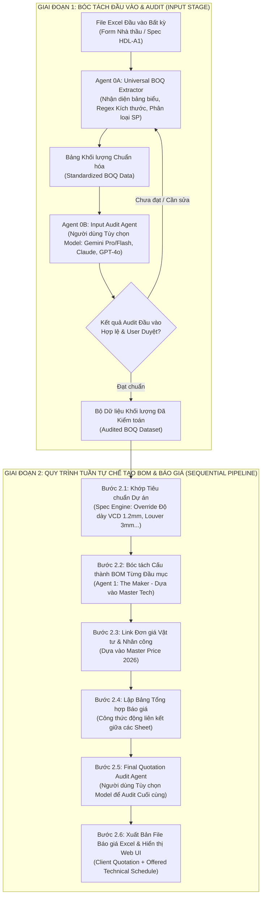

# QUY TRÌNH MULTI-AGENT BÓC TÁCH KHỐI LƯỢNG ĐA ĐỊNH DẠNG & LẬP BÁO GIÁ SWIND

> **Tài liệu Kế hoạch Triển khai (Engineering Execution Plan v2.0)**  
> **Áp dụng cho**: Mọi file Excel yêu cầu báo giá thực tế từ các nhà thầu / Chủ đầu tư (Không theo form cố định) & Dự án điển hình HDL-A1  
> **Thư mục lưu trữ**: `plan/`  
> **Hệ thống áp dụng**: Swind Multi-Agent Costing & Estimating System (Swind MAS)  
> **Cập nhật ngày**: 10/10/2026  

---

## I. NGUYÊN LÝ THAY ĐỔI & ĐẦU BÀI THỰC TẾ

Trong thực tế thi công cơ điện (HVAC), các file Excel gửi yêu cầu báo giá từ các Nhà thầu chính / Chủ đầu tư / Đơn vị thiết kế **hoàn toàn không theo một khuôn mẫu cố định nào**:
- Có nhà thầu để kích thước riêng ở cột $W$ và $H$, có nhà thầu viết gộp trong cột Tên sản phẩm (ví dụ: *"Cửa gió nan T 800x200 sơn tĩnh điện"* hoặc *"Van gió VCD-D250 L=200"*).
- Vị trí các dòng tiêu đề (Header), số thứ tự, đơn vị tính, tên sheet thay đổi tùy ý giữa các dự án.
- Có dự án kèm file Spec kỹ thuật riêng (như file `input/HDL-A1 HVAC TECHNICAL DATA.xls` quy định độ dày tôn VCD tối thiểu 1.2mm, nhôm louver dày 3.0mm...).

Do đó, hệ thống Swind MAS được thiết kế theo **Kiến trúc 2 Giai đoạn Độc lập (Two-Stage Decoupled Architecture)**:
1. **Giai đoạn 1**: Phân tích thông minh, bóc tách cấu thành & chuẩn hóa khối lượng từ file Excel bất kỳ + **Agent Audit Đầu vào (Được quyền chọn Model AI để audit)**.
2. **Giai đoạn 2**: Khi và chỉ khi kết quả bóc tách đầu vào được xác nhận hợp lệ, hệ thống mới chạy **Quy trình tuần tự chế tạo BOM & lập báo giá** + **Agent Audit Báo giá Cuối cùng (Được quyền chọn Model AI)**.

---

## II. SƠ ĐỒ LUỒNG HOẠT ĐỘNG TOÀN DIỆN (SYSTEM ARCHITECTURE)

---

## III. CHI TIẾT GIAI ĐOẠN 1: BÓC TÁCH KHỐI LƯỢNG ĐẦU VÀO & AUDIT ĐỘC LẬP

### 1. Agent 0A: Universal BOQ Ingestion & Extractor
Module phụ trách: `src/swind_universal_extractor.py`  
Khả năng xử lý đối với file Excel bất kỳ của mọi nhà thầu:
* **Nhận diện Bảng biểu Động (Dynamic Table & Header Detection)**:
  * Tự động quét toàn bộ các sheet, bỏ qua các dòng logo/thông tin hành chính trên đầu.
  * Dùng thuật toán so khớp mờ (Fuzzy matching) nhận diện các cột mấu chốt:
    * `STT` / `No.` / `Item`
    * `Tên vật tư` / `Mô tả` / `Chủng loại` / `Description`
    * `Kích thước` / `Quy cách` / `W x H` / `D` / `Size`
    * `ĐVT` / `Unit`
    * `Khối lượng` / `Số lượng` / `Qty`
    * `Vị trí` / `Hệ thống` / `Ghi chú`
  * Tự động unmerge các ô bị gộp dòng/gộp cột để không mất dữ liệu.
* **Bóc tách Kích thước Thông minh (Intelligent Dimension Parsing)**:
  * Trích xuất chính xác $W, H, L, D$ từ chuỗi văn bản tự do:
    * Dạng tích: `800x400`, `800*400`, `800 x 400 x 1000` ➔ $W=800, H=400, L=1000$.
    * Dạng đường kính: `D200`, `D 250`, `Ø300`, `Phi 150` ➔ $D=200$ (Hình tròn).
    * Dạng nan khe: `Slot 2-1000`, `Linear 1200x150` ➔ $L=1200, W=150$, Số khe = 2.
* **Chuẩn hóa Phân loại Sản phẩm Swind (Standard Taxonomy Mapping)**:
  * Tự động phân loại từng dòng vào 5 nhóm sản phẩm cốt lõi của Swind:
    1. `VAN_GIO`: VCD (chữ nhật, tròn), NRD (1 chiều), FD (cầu chì 74°C), MFD (chống cháy gắn động cơ).
    2. `CUA_GIO`: Linear Bar Grille (nan T 1-2 lớp), Khuyếch tán (Diffuser 600x600, tròn), Cửa ngoài trời Louver (nan Z chống mưa kèm lưới Inox).
    3. `TIEU_AM`: Hộp tiêu âm chữ nhật, Ống tiêu âm tròn, Tiêu âm buồng máy Rockwool 80kg/m³.
    4. `NOI_MEM`: Nối mềm vuông Canvas, Nối mềm tròn, Bạt chống cháy tiêu chuẩn.
    5. `ONG_GIO`: Ống vuông bích TDC/bích C, ống tròn xoắn, phụ kiện cút, côn, tê.

### 2. Agent 0B: Input Audit Agent (Cho phép Lựa chọn Model AI)
Sau khi Agent 0A xuất ra bảng bóc tách trung gian, hệ thống **bắt buộc chạy qua Agent Audit Đầu vào**:
* **Lựa chọn Model Audit**: Người dùng có thể chọn Model mong muốn trên giao diện Web UI:
  * `Gemini 2.5 Pro` (Mặc định cho khả năng suy luận logic sâu và đọc bảng biểu).
  * `Gemini 2.5 Flash` (Tốc độ cao, tối ưu cho dự án khối lượng lớn).
  * `Claude 3.7 Sonnet` / `GPT-4o` (Tùy chọn mô hình audit độc lập bên thứ 3).
* **Tiêu chí Kiểm toán Đầu vào (Input Audit Checklist)**:
  1. **Độ đầy đủ (Completeness)**: Có dòng nào trong file gốc bị bỏ sót hoặc parse thiếu không? Tổng số lượng cái/bộ có khớp 100% với file gốc?
  2. **Độ chính xác kích thước (Dimension Integrity)**: Kích thước $W, H, L, D$ có hợp lệ trong kỹ thuật HVAC không (ví dụ $W > 0, H > 0$, không bị đảo lộn thứ nguyên)?
  3. **Độ chính xác phân loại (Classification Confidence)**: Kiểm tra chéo xem có bị nhầm lẫn giữa Cửa gió và Van gió không (ví dụ nhầm Louver thành VCD)?
  4. **Cảnh báo bất thường (Anomaly & Edge Case Warning)**: Phát hiện các quy cách quá khổ, số lượng bất thường hoặc vật liệu đặc thù (Inox 304, tôn dày 1.2mm, nhôm 3mm) để kích hoạt cờ cảnh báo.
* **Kết quả**:
  * Tạo file `data/projects/INPUT_EXTRACTION_AUDIT_REPORT.json`.
  * Hiển thị bảng kết quả đã phân tích lên Web UI để User xem xét và bấm nút **"Xác nhận khối lượng đầu vào & Chạy báo giá"**.

---

## IV. CHI TIẾT GIAI ĐOẠN 2: QUY TRÌNH TUẦN TỰ CHẾ TẠO BOM & LẬP BÁO GIÁ

Khi bước bóc tách đầu vào đã có dữ liệu chuẩn được duyệt, hệ thống kích hoạt chạy tuần tự 6 bước cốt lõi:

### Bước 2.1: Khớp Tiêu chuẩn Kỹ thuật Dự án (Project Spec Engine)
* Nếu dự án có file Spec đính kèm (như `HDL-A1 HVAC TECHNICAL DATA.xls`), hệ thống tự động trích xuất các quy tắc ràng buộc (Spec Override):
  * Độ dày tôn thân vỏ van VCD: Bắt buộc tối thiểu 1.2mm (thay vì 0.8mm).
  * Độ dày cánh van VCD: Bắt buộc tối thiểu 1.2mm.
  * Cửa ngoài trời Louver: Khung nhôm mặt bích 3.0mm, hộp 1.2mm, nan 1.2mm + lưới chắn côn trùng Inox.
  * Tiêu âm: Bông khoáng Rockwool tỷ trọng 80kg/m³ dày 50mm + tôn lỗ 0.48mm Z275 + vải thủy tinh.
* Đồng thời tự động điền các thông số cam kết của Swind vào cột `OFFERED` để làm hồ sơ chào thầu kỹ thuật.

### Bước 2.2: Bóc tách Cấu thành BOM Từng Đầu mục (Agent 1 - The Maker)
* Gọi `src/swind_bom_engine.py` kết nối với `data/master_data/master_database_tech.json`.
* Phân rã cấu thành chi tiết cho từng mã sản phẩm theo kích thước cụ thể:
  * **Van VCD (WxHxL)**:
    * Diện tích tôn vỏ thân ($m^2$ tôn Z180 dày 1.2mm).
    * Số lượng cánh, diện tích tôn cánh ($m^2$ tôn Z180 dày 1.2mm).
    * Số bộ bánh răng truyền động (bánh răng thép/nhựa), cốt trục thép, bạc đồng chịu mài mòn.
    * 01 tay vặn bánh cóc hoặc tay gạt vô cấp.
    * Nhân công cắt chấn CNC, nhân công lắp ráp hoàn thiện.
  * **Cửa Louver (WxH)**:
    * Chiều dài khung nhôm định hình mặt bích 3.0mm + hộp 1.2mm ($md$ hoặc $kg$).
    * Số lượng nan Z, chiều dài nan Z nhôm 1.2mm.
    * Diện tích lưới chắn côn trùng Inox 304 ($m^2$).
    * Sơn tĩnh điện ngoài trời.
    * Nhân công lắp ráp, ke góc gia cường.
  * **Tiêu âm Rockwool (WxHxL)**:
    * Vỏ tôn bao ngoài Z180.
    * Bông khoáng Rockwool 80kg/m³ dày 50mm.
    * Tôn mạ kẽm đột lỗ dày 0.48mm Z275 + vải thủy tinh.
    * Nhân công đóng hộp và xử lý tiêu âm.

### Bước 2.3: Link Đơn giá từ Master Price Database (Costing Engine)
* Kết nối trực tiếp vào `data/master_data/master_database_price.json`:
  * Ánh xạ chính xác giá tôn Hoa Sen Z180 theo từng độ dày (0.58, 0.75, 0.95, 1.15, 1.2mm).
  * Ánh xạ đơn giá nhôm profile đùn A6063.
  * Ánh xạ đơn giá Rockwool 80kg/m³, tôn lỗ Z275, phụ kiện cơ khí van gió.
  * Áp dụng chi phí nhân công theo định mức Swind 2026.
  * Tự động cộng hệ số khấu hao xưởng, vật tư phụ, chi phí chung (12% - 15%) và lợi nhuận định mức (10% - 15%).

### Bước 2.4: Lập Bảng Tổng hợp Báo giá với Công thức Động
* Tạo file Excel hoàn chỉnh gồm 7 Sheet:
  1. `TONG_HOP_BAO_GIA`: Bảng chào giá chính thức gửi khách hàng.
     * Toàn bộ đơn giá lấy theo link công thức động: `=BOM_VAN_GIO!F18`, `=BOM_CUA_GIO!F25`...
     * Toàn bộ thành tiền bằng `=Khối lượng * Đơn giá`.
     * Tổng tiền hàng trước thuế `=SUM(...)`, Thuế VAT 8% hoặc 10%, Tổng tiền thanh toán.
  2. `OFFERED_TECHNICAL_SCHEDULE`: Bảng chào kỹ thuật khớp 100% hồ sơ mời thầu.
  3. `BOM_VAN_GIO`: Bảng tính chi tiết cấu thành vật tư và giá thành cho từng mã van.
  4. `BOM_CUA_GIO`: Bảng tính chi tiết cấu thành cửa gió nan Bar, Diffuser, Louver.
  5. `BOM_TIEU_AM`: Bảng tính chi tiết hộp tiêu âm và ống tiêu âm.
  6. `BOM_PHU_KIEN_NOI_MEM`: Bảng tính chi tiết nối mềm Canvas.
  7. `MASTER_DON_GIA_THAM_CHIEU`: Bảng giá gốc làm căn cứ giải trình.

### Bước 2.5: Final Quotation Audit Agent (Lựa chọn Model AI)
* Người dùng tiếp tục được lựa chọn Model AI để thực hiện bước **Kiểm toán chất lượng báo giá cuối cùng**:
  * Kiểm toán 4 tiêu chuẩn độc lập:
    1. *Spec Compliance*: 100% độ dày và vật liệu đáp ứng đúng yêu cầu khắt khe của dự án.
    2. *Formula Integrity*: 100% công thức liên kết giữa các Sheet vẹn toàn, không có lỗi gãy `#REF!`, `#VALUE!`, không hard-code số tiền chết trên bảng tổng hợp.
    3. *Price Consistency*: Đơn giá đầu vào khớp với Master Price Database 2026.
    4. *Arithmetic Audit*: Kiểm tra lại toàn bộ phép tính nhân chia cộng trừ.
* Sinh biên bản `data/projects/FINAL_QUOTATION_AUDIT_REPORT.json`.

### Bước 2.6: Xuất bản Báo giá & Trình diễn trên Web UI
* Lưu file Excel chính thức tại `data/projects/SWIND_QUOTATION_VERIFIED.xlsx`.
* Cập nhật Dashboard trên Web UI để người dùng xem trực quan và tải file về máy.

---

## V. GIAO DIỆN NGƯỜI DÙNG WEB UI TÍCH HỢP 2 BƯỚC AUDIT

Trên giao diện Web (`./start`):
1. **Khu vực Nạp file & Bóc tách (Step 1)**:
   * Ô kéo thả/chọn file Excel đầu vào bất kỳ (hoặc chọn file mặc định `HDL-A1 HVAC TECHNICAL DATA.xls`).
   * Menu thả xuống **"Chọn AI Model Audit Bóc tách Đầu vào"** (Gemini Pro, Flash, Claude, GPT).
   * Nút **"Bóc tách & Audit Khối lượng"**.
   * Bảng hiển thị kết quả phân tích khối lượng kèm Báo cáo Audit đầu vào (cho phép sửa trực tiếp nếu muốn).
2. **Khu vực Chạy Báo giá Tuần tự (Step 2)**:
   * Sau khi duyệt kết quả Step 1, nút **"Tiến hành Chạy Quy trình Báo giá Tuần tự"** sẽ sáng lên.
   * Menu thả xuống **"Chọn AI Model Audit Báo giá Cuối cùng"**.
   * Bấm nút chạy ➔ Hệ thống tự động tính toán BOM chi tiết, link Master Price, link Bảng tổng hợp và thực hiện Audit chéo.
   * Hiển thị bảng tổng hợp báo giá, thông báo tình trạng Audit (Pass 100%) và nút **"Tải File Excel Báo Giá Hoàn Chỉnh"**.

---

## VI. LỘ TRÌNH TRIỂN KHAI THEO TỪNG GIAI ĐOẠN

| Giai đoạn | Module thực hiện | Kết quả bàn giao (Deliverables) |
|---|---|---|
| **Phase 1** | Xây dựng Agent 0A Universal Extractor & Agent 0B Input Audit Agent | `src/swind_universal_extractor.py` & `src/swind_input_auditor.py` |
| **Phase 2** | Thử nghiệm bóc tách và audit trên file thực tế `HDL-A1 HVAC TECHNICAL DATA.xls` | `data/projects/HDL_A1_EXTRACTED_BOQ.json` & `INPUT_AUDIT_REPORT.json` |
| **Phase 3** | Xây dựng Động cơ BOM tuần tự tích hợp Spec Override của dự án | `src/swind_project_engine.py` (Tính toán chi tiết 4 nhóm SP) |
| **Phase 4** | Xây dựng Bộ tạo Excel liên kết công thức động & Agent Audit cuối cùng | `data/projects/HDL_A1_BAO_GIA_HE_THONG_HVAC.xlsx` & `FINAL_AUDIT_REPORT.json` |
| **Phase 5** | Nâng cấp giao diện Web UI hiển thị quy trình 2 bước và bộ chọn Model Audit | Cập nhật toàn diện `frontend/index.html` và `frontend/script.js` |
